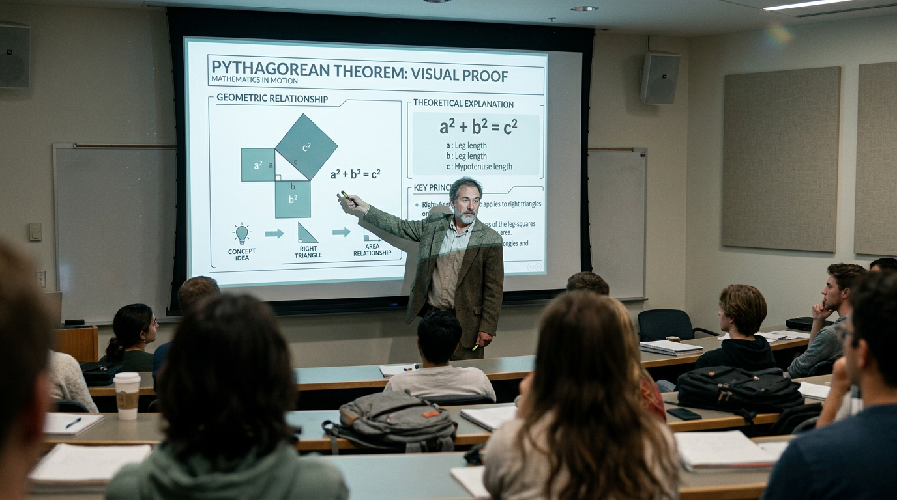
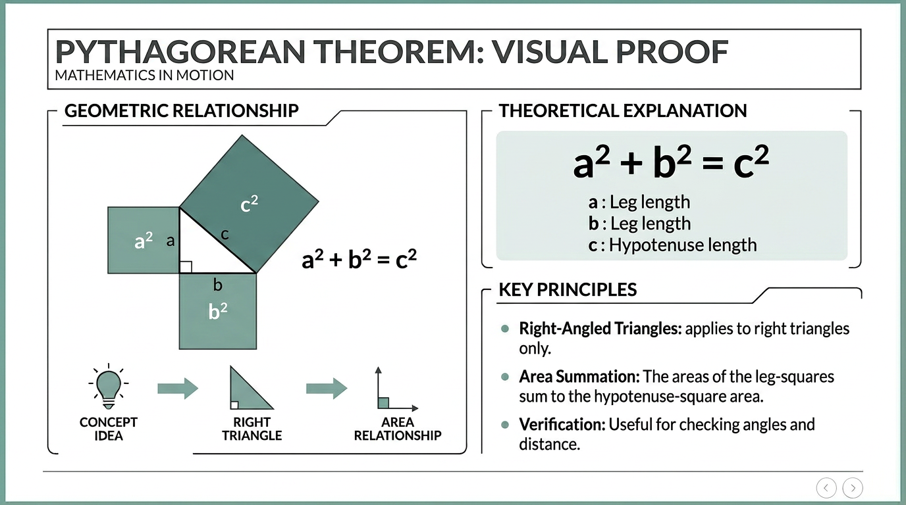
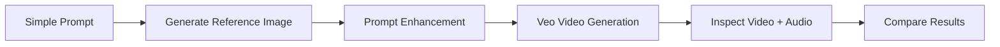

# Prompt Engineering for Video Generation

<div align="center">

[](https://cloud.google.com/vertex-ai/generative-ai/docs/video)
[](https://www.python.org/)
[](https://jupyter.org/)
[](https://cloud.google.com/vertex-ai)

**Turn a simple idea into a directed, cinematic video with Google's Veo models.**



</div>

---

## 🎬 What You Will Build

This hands-on lesson takes you from a plain text description to a polished video generation workflow. You will create a reference image, transform an ordinary prompt into a production-style brief, and compare original and enhanced video outputs.

| | |
|:--|:--|
| 🎥 **Text-to-video** | Describe a subject, camera, environment, motion, lighting, and sound. |
| 🖼️ **Image-to-video** | Use a generated image as a visual reference for a new video scene. |
| ✨ **Prompt enhancement** | Upgrade sparse instructions into a detailed, shot-ready prompt. |
| 🔊 **Generated audio** | Explore synchronized dialogue and environmental sound. |
| ⏳ **Async operations** | Poll long-running Veo jobs until rendered media is ready. |
| 🔬 **Visual evaluation** | Compare source, intermediate, and final outputs side by side. |

---

## 🖼️ Lesson Visual

<table>
  <tr>
    <td width="50%" align="center">
      
      <b>Reference slide</b>
    </td>
    <td width="50%" align="center">
      
      <b>Generated classroom scene</b>
    </td>
  </tr>
</table>

---

## 🎞️ Example Outputs

<table>
  <tr>
    <th width="50%">Original Prompt</th>
    <th width="50%">Enhanced Prompt</th>
  </tr>
  <tr>
    <td align="center">
      <video src="./original.mp4" controls width="100%"></video>
      <br>
      <a href="./original.mp4"><b>▶️ Open original.mp4</b></a>
    </td>
    <td align="center">
      <video src="./enhanced.mp4" controls width="100%"></video>
      <br>
      <a href="./enhanced.mp4"><b>▶️ Open enhanced.mp4</b></a>
    </td>
  </tr>
</table>

> The enhanced example demonstrates how richer camera, timing, lighting, composition, and negative prompt details can improve the final result.

---

## 🧭 Notebook Journey



1. **Start simple** — establish the subject and core action.
2. **Generate a reference** — create a source image for stronger visual control.
3. **Enhance the brief** — add cinematography, environment, pacing, and constraints.
4. **Submit the generation** — call Veo and track the asynchronous operation.
5. **Review the output** — inspect motion, composition, continuity, and audio.

---

## 📝 Anatomy of a Strong Video Prompt

Use this repeatable structure for reliable, cinematic results:

```text
[SHOT TYPE + CAMERA MOVEMENT]
[SUBJECT AND VISIBLE ACTION]
[ENVIRONMENT + TIME OF DAY]
[LIGHTING + COLOR PALETTE]
[MOTION + PACING + DURATION]
[AUDIO: DIALOGUE, AMBIENCE, OR EFFECTS]
[NEGATIVE CONSTRAINTS]
```

### Example

```text
Slow dolly shot through a futuristic greenhouse at sunrise.
Autonomous watering drones pass between glass panels as vines open toward the light.
Soft atmospheric haze, restrained orange and teal palette, natural mechanical sounds.
Duration: 8 seconds. No abrupt cuts, no readable text, no flickering.
```

<details>
<summary><b>✨ Prompt enhancement example</b></summary>

```text
A professional 8-second tracking shot glides smoothly between illuminated
glass greenhouse panels. In the foreground, an autonomous drone gently
sprays water across cinematic vines while the first sunrise rays sweep
across the leaves. Slow, elegant motion with shallow depth of field,
natural mechanical ambience, and subtle water droplets. Warm morning
highlights contrast against cool teal shadows. No text, no jump cuts,
no visible mistakes, and no excessive camera shake.
```

</details>

---

## 🚀 Quick Start

### 1. Create a virtual environment

```powershell
python -m venv .venv
.\.venv\Scripts\Activate.ps1
python -m pip install --upgrade pip
python -m pip install -r requirements.txt
```

### 2. Configure Google Cloud authentication

Place a service account key in the repository as `credentials.json`, or set:

```powershell
$env:GOOGLE_APPLICATION_CREDENTIALS = "C:\path\to\credentials.json"
```

The notebook and [`helper.py`](helper.py) load the credential file, refresh Google authentication, enable Vertex AI, and return the active project ID.

### 3. Launch the notebook

```powershell
jupyter lab vide_generation.ipynb
```

Run the cells in order. Video generation is asynchronous and may take several minutes. The notebook polls the operation until the generated media is available.

---

## 📦 Project Files

| File | Purpose |
|---|---|
| [`vide_generation.ipynb`](vide_generation.ipynb) | Complete prompt engineering lesson and generation workflow |
| [`helper.py`](helper.py) | Google authentication and notebook display utilities |
| [`requirements.txt`](requirements.txt) | Python dependencies |
| [`original.mp4`](original.mp4) | Video generated from the original prompt |
| [`enhanced.mp4`](enhanced.mp4) | Video generated from the enhanced prompt |
| [`slide-image.png`](slide-image.png) | Source slide visual |
| [`video-image.png`](video-image.png) | Generated classroom reference image |

---

## 🎯 Tips for Better Results

- ✅ Use explicit camera language: **dolly**, **crane**, **tracking**, **handheld**, or **aerial**
- ✅ Specify the motion and its speed: **slow**, **gradual**, **fast**, or **suddenly**
- ✅ Define lighting: **golden hour**, **diffused**, **backlit**, or **low key**
- ✅ Describe shot composition: **wide establishing shot**, **close-up**, or **shallow depth of field**
- ✅ Include duration and pacing to keep results controlled
- ✅ Add negative prompts for text, blur, flicker, jump cuts, and distortion
- ✅ Preserve prompts and outputs to build reproducible comparison experiments

---

## 💰 Usage and Safety

Video generation can take longer and cost more than image generation. Review your Google Cloud billing, quotas, model availability, and project region before running many generations.

Generate only media you have permission to use or distribute, and avoid depicting real people, private locations, or sensitive activities without appropriate consent.

---

<div align="center">

**From a sentence to a scene — refine, generate, evaluate, repeat.**

</div>
