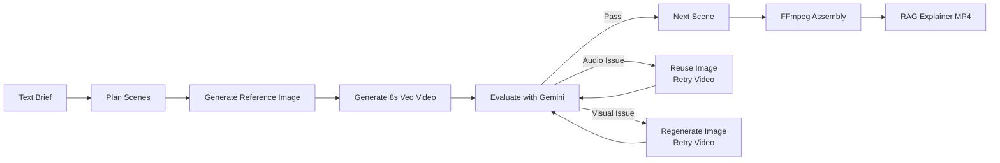
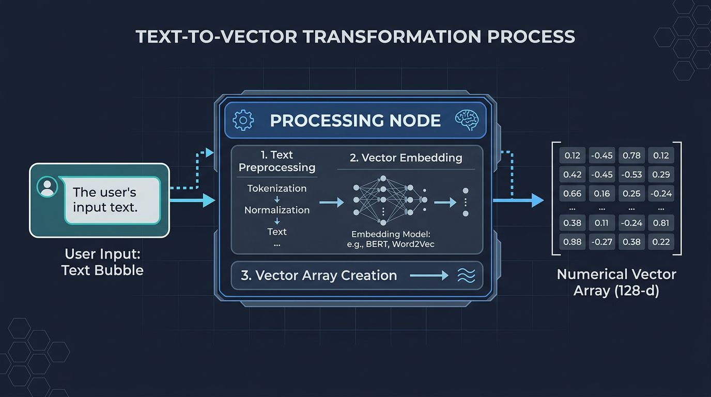
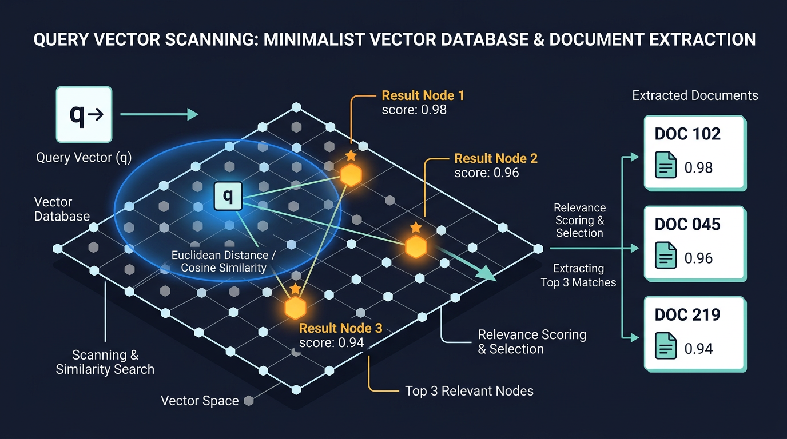
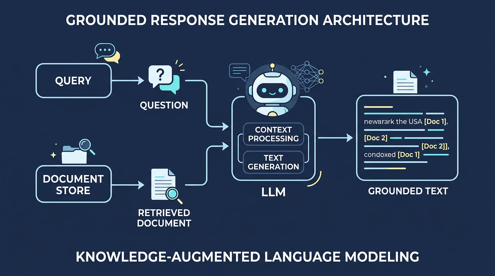

# Video Generation Agent

<div align="center">

[](https://ai.google.dev/)
[](https://cloud.google.com/vertex-ai/generative-ai/docs/video)
[](https://google.github.io/adk-docs/)
[](https://www.python.org/)
[](https://jupyter.org/)

**A self-evaluating AI video production agent that plans scenes, generates reference art, renders narrated clips, and retries failed scenes.**

</div>

---

## 🎬 Final Example

The notebook turns this brief:

> “Explain how RAG works — embedding the query, retrieving relevant documents, and generating a grounded answer.”

into a complete, narrated RAG explainer.

<div align="center">
  <video src="./rag_explainer.mp4" controls width="800"></video>
  <br>
  <a href="./rag_explainer.mp4"><b>▶️ Open the complete video</b></a>
</div>

---

## ✨ What This Agent Does

| Capability | Result |
|---|---|
| **Scene planning** | Gemini converts a text brief into a structured, three-scene shot plan |
| **Reference generation** | Gemini creates a consistent 16:9 technical diagram for each scene |
| **Video generation** | Veo animates each reference image into an 8-second narrated clip |
| **Quality evaluation** | Gemini watches the result and scores visual quality, motion, continuity, and narration |
| **Automatic recovery** | A failed scene is regenerated from the image step or video step, with one retry |
| **Final assembly** | FFmpeg concatenates the passing scenes into one MP4 |

---

## 🖼️ Scene Pipeline

Each scene follows the same controlled production loop:



---

## 🎞️ Generated Scenes

<table>
  <tr>
    <th width="33%">Scene 1</th>
    <th width="33%">Scene 2</th>
    <th width="33%">Scene 3</th>
  </tr>
  <tr>
    <td align="center">
      
      <br>
      <video src="./scene_1.mp4" controls width="100%"></video>
      <br>
      <a href="./scene_1.mp4"><b>Open scene 1</b></a>
    </td>
    <td align="center">
      
      <br>
      <video src="./scene_2.mp4" controls width="100%"></video>
      <br>
      <a href="./scene_2.mp4"><b>Open scene 2</b></a>
    </td>
    <td align="center">
      
      <br>
      <video src="./scene_3.mp4" controls width="100%"></video>
      <br>
      <a href="./scene_3.mp4"><b>Open scene 3</b></a>
    </td>
  </tr>
</table>

---

## 🧰 Agent Tools

The notebook exposes four focused tools to the Google ADK agent:

### 1. `plan_scenes`

Breaks a short production brief into numbered scenes. Every scene includes:

- A clean visual description
- Approximately 20 words of narration for an 8-second clip
- A camera motion: `slow_left_to_right`, `slow_zoom_in`, `slow_zoom_out`, or `static`
- A shared voice profile

### 2. `generate_scene_image`

Uses Gemini image generation to produce a consistent technical-diagram reference frame. The generated PNG becomes the starting frame for Veo.

### 3. `generate_scene_video`

Uses a Veo model with the reference image to create a 16:9, 8-second MP4. The prompt includes the scene direction and expected narration, while generated audio is enabled.

### 4. `evaluate_scene`

Sends the generated MP4 back to Gemini for a scored review. The evaluator checks:

- Temporal consistency
- Motion coherence
- Prompt adherence
- Visual quality
- Narration alignment
- Voice profile
- Scene continuity

It returns a pass/fail decision, overall score, failure type, and actionable feedback.

---

## 🔁 Built-In Recovery Example

The demonstration intentionally gives scene 1 incorrect narration on its first attempt. The evaluator detects the mismatch, classifies the failure as audio, and directs the agent to reuse the existing image and regenerate the video with the real narration.

This makes the lesson visibly demonstrate:

1. Tool-using agent behavior
2. Quality gates
3. Audio-versus-visual failure diagnosis
4. Targeted rather than full-pipeline retries

---

## 🚀 Quick Start

### 1. Install dependencies

From this directory:

```powershell
python -m venv .venv
.\.venv\Scripts\Activate.ps1
python -m pip install --upgrade pip
python -m pip install -r requirements.txt
python -m pip install jupyterlab
```

### 2. Configure Google Cloud

Set the service-account key with an environment variable:

```powershell
$env:GOOGLE_APPLICATION_CREDENTIALS = "C:\path\to\credentials.json"
```

The included [`helper.py`](helper.py) also falls back to `credentials.json` in the current or parent directory.

Ensure your project has billing enabled and the required Gemini, Veo, and Vertex AI access. Model availability and permissions vary by project and region.

### 3. Install FFmpeg

FFmpeg is used in the final concatenation step.

```powershell
ffmpeg -version
```

If the command is unavailable, install FFmpeg and ensure `ffmpeg` is on `PATH`.

### 4. Run the notebook

```powershell
jupyter lab vid_generation.ipynb
```

Run the cells in order. The complete agent production run can take several minutes because each scene is generated asynchronously and is evaluated by Gemini before continuing.

---

## 📦 Project Files

| File | Purpose |
|---|---|
| [`vid_generation.ipynb`](vid_generation.ipynb) | End-to-end scene planning, generation, evaluation, and assembly notebook |
| [`helper.py`](helper.py) | Vertex AI authentication and notebook display helpers |
| [`requirements.txt`](requirements.txt) | Python dependencies |
| [`scene_1_ref.png`](scene_1_ref.png) | Generated reference frame for scene 1 |
| [`scene_2_ref.png`](scene_2_ref.png) | Generated reference frame for scene 2 |
| [`scene_3_ref.png`](scene_3_ref.png) | Generated reference frame for scene 3 |
| [`scene_1.mp4`](scene_1.mp4) | Generated 8-second scene 1 |
| [`scene_2.mp4`](scene_2.mp4) | Generated 8-second scene 2 |
| [`scene_3.mp4`](scene_3.mp4) | Generated 8-second scene 3 |
| [`rag_explainer.mp4`](rag_explainer.mp4) | Final concatenated RAG explainer |

---

## ⚙️ Model Configuration

The notebook currently defines:

```python
MODEL = "gemini-3.1-pro-preview"
IMAGE_MODEL = "gemini-3.1-flash-image"
VIDEO_MODEL = "veo-3.1-fast-generate-001"
```

These model IDs and SDK interfaces can change. If Google Cloud reports that a model is unavailable or deprecated, update the constants and verify the corresponding method names in the installed SDK.

---

## 🔐 Security and Cost

- Never commit a service-account key or credential JSON file.
- Prefer `GOOGLE_APPLICATION_CREDENTIALS` or Application Default Credentials.
- Image, video, and evaluation calls may incur Google Cloud charges.
- Check quotas and model availability before running the full agent.
- AI-generated media can vary between runs.

---

## 🧪 Troubleshooting

| Problem | Check |
|---|---|
| Credentials not found | Verify `GOOGLE_APPLICATION_CREDENTIALS` or place `credentials.json` beside the notebook |
| Permission denied | Confirm Vertex AI API access and the service account's project permissions |
| Quota or region error | Check billing, quota, location, and model availability |
| Video operation times out | The notebook allows 300 seconds per video; rerun or increase the timeout |
| `ffmpeg` not found | Install FFmpeg and restart the terminal/kernel |
| `ModuleNotFoundError` | Activate the virtual environment and reinstall `requirements.txt` |
| Results differ | Generated media is probabilistic; reruns may change motion, style, or audio |

---

<div align="center">

[← Back to the main workspace](../README.md)

</div>
